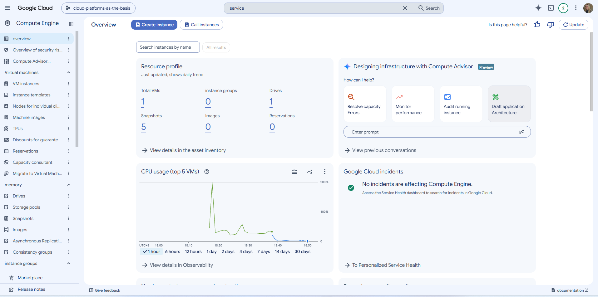
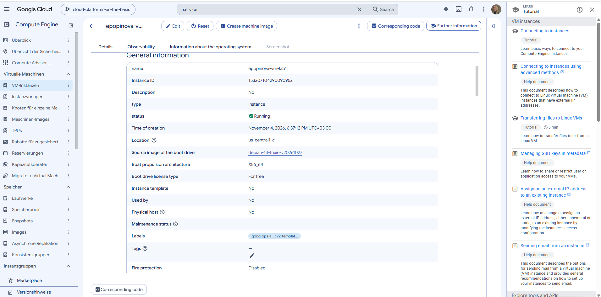
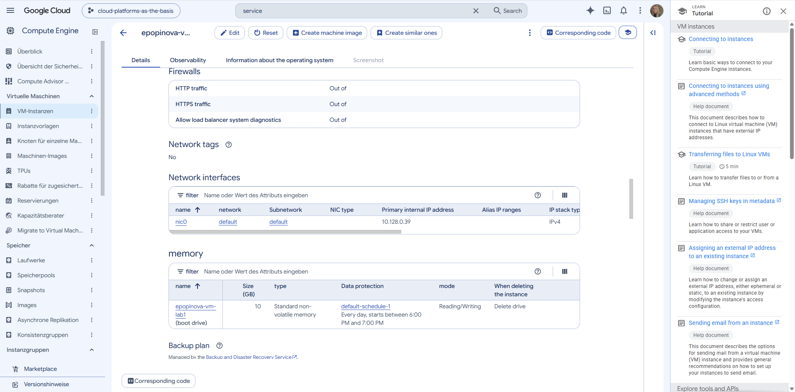
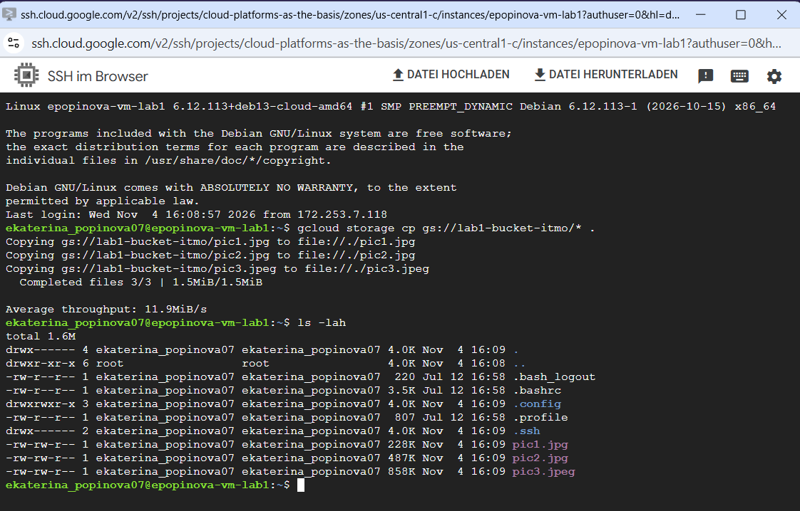
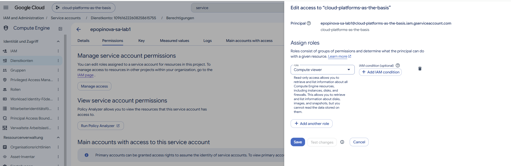

# Лабораторная работа №1

University: [ITMO University](https://itmo.ru/ru/)
Faculty: [FICT](https://fict.itmo.ru)
Course: [Cloud platforms as the basis of technology entrepreneurship](https://)
Year: 2026
Group: u4225
Author: Popinova E. D.
Lab: Lab1
Date of create: 04.11.2026
Date of finished: DD.MM.YYYY

---

## Цель работы

Ознакомиться с основными возможностями и преимуществами облачной платформы Google Cloud.

## Задачи

1. Получить доступ к Google Cloud (заполнить гугл-форму).
2. Создать service account с ролью Storage Admin.
3. Создать минимальную Compute Engine (VM) с Machine type e2-micro в режиме spot.
4. С помощью утилиты gcloud найти бакет `lab1-bucket-itmo` и скопировать 3 файла на VM.
5. Изменить права service account с Storage Admin на Compute Viewer и повторить копирование.
6. Удалить созданные ресурсы и сделать выводы.

## Ход работы

### 1. Получение доступа к Google Cloud

Заполнила гугл-форму, приложив свою Gmail-почту. Получила доступ к проекту Google Cloud `cloud-platforms-as-the-basis`.

### 2. Создание service account

Перешла в **IAM & Admin → Service Accounts → Create Service Account**.

- **Имя:** `epopinova-sa-lab1`
- **Роль:** `Storage Admin` (Cloud Storage → Storage Admin)

### 3. Создание виртуальной машины

Перешла в **Compute Engine → VM instances → Create Instance**.

- **Имя:** `epopinova-vm-lab1`
- **Machine type:** `e2-micro`
- **Provisioning model:** `Spot`

После создания подключилась к VM по SSH (кнопка SSH в консоли Google Cloud).

### 4. Копирование файлов из бакета на VM

Находясь в SSH-сессии на VM, выполнила:
gcloud storage cp gs://lab1-bucket-itmo/* .

Результат: успешно скопированы 3 файла — pic1.jpg, pic2.jpg, pic3.jpeg.

### 5. Смена роли service account и повторная попытка копирования файлов

В IAM & Admin → IAM изменила роль epopinova-sa-lab1 со Storage Admin на Compute Viewer.

При повторной попытке копирования выяснилось, что команда gcloud на VM по умолчанию выполняется от имени Compute Engine default service account (307056602443-compute@developer.gserviceaccount.com), у которого есть широкие права (роль Editor), поэтому копирование всё ещё проходило успешно.

Чтобы проверить права именно epopinova-sa-lab1, выполнила проверку активного аккаунта и повторила копирование с явным указанием нужного аккаунта:
gcloud auth list
gcloud storage cp gs://lab1-bucket-itmo/* . --account=epopinova-sa-lab1@cloud-platforms-as-the-basis.iam.gserviceaccount.com

Результат — ожидаемая ошибка доступа:
ERROR: (gcloud.storage.cp) ... does not have storage.objects.list access to the Google Cloud Storage bucket.

## Результат
В ходе лабораторной работы были освоены базовые операции в Google Cloud: создание service account с ролью Storage Admin, создание минимальной spot-VM, копирование файлов из Cloud Storage на VM с помощью gcloud storage cp, проверка влияния смены прав доступа на возможность выполнения операций.

## Выводы
Google Cloud предоставляет удобный веб-интерфейс и CLI (gcloud) для управления облачными ресурсами: service accounts, виртуальными машинами и Cloud Storage.

Роль Storage Admin даёт полный доступ к объектам Cloud Storage и позволяет копировать файлы из бакета на VM.

После смены роли на Compute Viewer доступ к Cloud Storage для этого аккаунта пропадает — роль содержит только права на просмотр ресурсов Compute Engine, но не включает разрешения storage.objects.list и storage.objects.get. Это подтверждает действие принципа минимальных привилегий.

Изменения IAM вступают в силу не мгновенно — требуется время (обычно 2–7 минут) на распространение политики.

Важно контролировать, от имени какого аккаунта выполняются команды gcloud: на VM по умолчанию активен Compute Engine default service account, что может маскировать эффект от изменения прав другого service account. Проверка через gcloud auth list и явное указание --account помогают избежать ложных результатов.

Spot-VM подходит для кратковременных задач, но может быть остановлена облаком в любой момент, поэтому для продакшена её использовать рискованно.